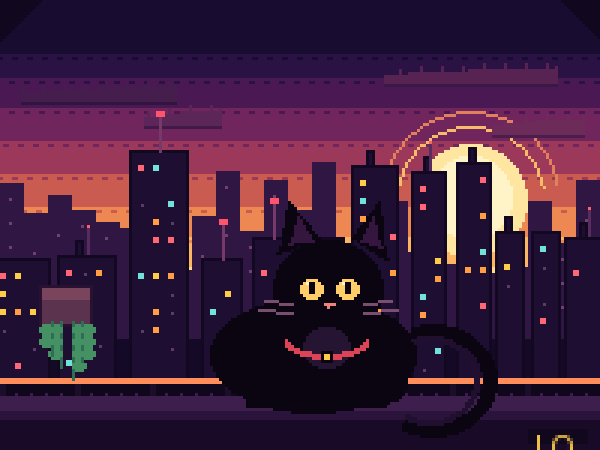
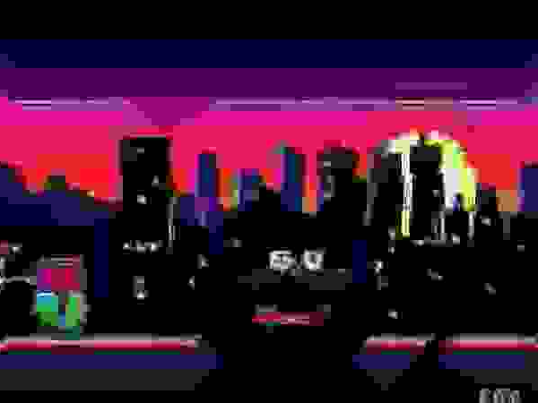

#  LowQuality

### Make your images look worse.

<p><a href="https://rafelolv.github.io/lowquality/">Try it live ↗</a></p>

LowQuality is a browser-only image destruction studio. Drop in a JPEG, PNG, WebP, BMP, AVIF, SVG, or animated GIF, crank the **HOW BAD?** slider, and download the evidence. Every pixel is processed inside the tab: there is no backend, no account, no server upload, and no analytics.

The interface is a deliberately unsubtle retro 8-bit console: dark purple checkerboard, thick violet panels, gold buttons, pixel typography, a tiny skyline, and Bitrot the mascot.

|                                           Before                                           |                                                    After                                                    |
| :----------------------------------------------------------------------------------------: | :---------------------------------------------------------------------------------------------------------: |
|  |  |

## Features

- **Real local processing** in a Web Worker, using Canvas, `OffscreenCanvas`, and `createImageBitmap`.
- **Animated GIF support** with per-frame degradation, preserved frame delays, disposal-aware compositing, transparency, and NETSCAPE loop metadata.
- **Independent text layers** with duplication, visibility, deletion, fonts, alignment, outline, and keyboard/pointer positioning.
- **Text that gets destroyed too.** Text layers are rasterized and baked into the image _before_ compression, noise, pixelation, or glitches are applied.
- **Quality slider from 0 to 100.** Zero preserves the source. Higher values favor JPEG ringing, chroma bleed, generation loss, and smooth resolution loss. Noise, palette reduction, contrast/saturation, sharpening, and light signal damage provide seasoning. Hard pixelation is opt-in through **Pixel Disaster** or the advanced Pixelation control; other presets keep it off, even at 100.
- **Six presets:** Original, Slightly Cursed, Crunchy JPEG, Pixel Disaster, Deep Fried, and Absolute Garbage.
- **Ten advanced controls**, each individually toggleable. Manual values survive slider changes; choosing a preset starts a fresh automatic curve.
- **Reset edits** restores the original pixels and removes added text while keeping the loaded file. Clear removes the file entirely.
- **Live preview** with original/result/compare modes, playback for GIFs, fit-to-window zoom, and a draggable text box.
- **Exports:** PNG, JPG, WebP, and animated GIF. Copying a destroyed PNG to the clipboard is supported where the browser allows it.
- **LowQuality Toolbox:** a separate, local-only workspace at `#toolbox` with six practical image tools: Resize & Crop, Batch, Metadata, Favicon, Redact, and GIF Kit. Each has its own hash route, and stills stay loaded while switching tools.
- **Mercy tools:** convert stills between PNG, JPG, and WebP without applying any degradation.
- **Target-size compressor:** pick a percentage, a fixed budget, or type a custom MB target. The worker searches for the highest WebP or JPG quality that fits, with optional resolution caps and a minimum-quality floor so dimensions only shrink when the target truly demands it.
- **Safe limits and scaling options** before a GIF can exhaust memory.
- **Responsive, keyboard-friendly, accessible UI** with reduced-motion support. Uploading compacts the header and focuses the editor. Preview and HOW BAD? stay together, presets use a compact grid, the desktop studio follows expanded controls, and mobile download/copy/progress/cancel actions stay in a bottom dock.
- **No remote runtime requests** beyond loading the page, its locally bundled fonts, and the bundled sample artwork.

## Toolbox

The Toolbox is a separate workspace that shares the LowQuality shell, tokens, and local processing rules without changing the destruction editor. Every tool is hash-routed for GitHub Pages:

| Route               | Tool                                  |
| ------------------- | ------------------------------------- |
| `#toolbox`          | Tool landing and tool cards           |
| `#toolbox/resize`   | Resize, crop, rotate, flip, and encode |
| `#toolbox/batch`    | Multi-file queue with ZIP download    |
| `#toolbox/metadata` | Read EXIF/GPS and reencode clean files |
| `#toolbox/favicon`  | PNG icons, multi-size ICO, manifest    |
| `#toolbox/redact`   | Pixelate or blur exported regions      |
| `#toolbox/gif`      | GIF recode, reverse, speed, extract    |

Stills stay loaded while switching between single-file tools. Heavy decoding, transformation, compression, and GIF work runs in `src/workers/toolkit.worker.ts`; files never leave the tab.

## Quick start

Requirements: Node.js 20.19+ or 22.12+ and npm (Vite 7 requirements).

```bash
npm install
npm run dev
```

Open the URL printed by Vite. To test the production bundle:

```bash
npm run build
npm run preview
```

Other useful scripts:

```bash
npm run typecheck   # strict TypeScript for the app and the worker
npm test            # Vitest pure-processing suite
npm run test:e2e    # Playwright browser suite
npm run format      # Prettier
```

### Running the browser tests

```bash
npx playwright install chromium
npm run test:e2e
npm run test:e2e:production # build and test the actual static production bundle
```

Finite GIF loops stop on the final frame in the processed preview and can be replayed. Infinite loops remain continuous. Original GIF playback is handled by the browser.

The Playwright suite covers JPEG/WebP input decoding, PNG alpha through degradation and export, every preset and individual effect, independent text duplication, immediate text exports, finite GIF loops, the empty state and bundled demo, sample loading, quality 0/50/100 behavior, presets and persistent overrides, text baked into pixels, compare/zoom controls, PNG/JPG/WebP downloads, clipboard copy, animated GIF playback, GIF export timing and looping, oversized-GIF scaling, unsupported files, mobile overflow, and every Toolbox flow from upload through download (including ZIP, redaction pixels, EXIF/GPS removal, and GIF frame timing).

## Supported formats and limits

| Input                                         | Output                       |
| --------------------------------------------- | ---------------------------- |
| JPEG, PNG, WebP, BMP, AVIF, SVG, animated GIF | PNG, JPG, WebP, animated GIF |

- **HEIC/HEIF is intentionally rejected** with a friendly explanation, because browser support is unreliable.
- Animated WebP and APNG are treated as still images; only GIF supports animation.
- SVG files are sanitized before rasterization: scripts, event handlers, embedded frames, and external references are removed.
- Static images: up to **30 MB**, **32 megapixels**, and **8192 px** per side.
- SVG: up to **5 MB** after the static size checks.
- Animated GIFs: up to **25 MB**, **240 frames**, **1600 px** per side, and **36 million decoded pixels** in total.
- Source GIF screens and individual patches are limited to **8 megapixels** before decoding. Larger sources must be resized externally: scaling the output cannot make the original disposal canvas smaller. Patches decode one at a time to avoid retaining all unscaled frames.
- Oversized GIFs enter a scaling dialog with safe working-size options. Every frame, delay, and loop is kept.
- Previews are capped at 1400 px for stills and 900 px / 14 megapixels for GIFs. Exports use the loaded working resolution.

At quality 0 with no advanced overrides or text, still exports preserve the decoded source pixels (PNG; JPEG/WebP export encoding may be lossy). Static previews preserve source pixels within the 1400 px preview limit; larger images use a scaled preview. Animated GIFs still have to be re-composited and re-encoded, so GIF quantization is unavoidable on GIF export even when no damage is requested.

## How the damage works

`src/lib/degradation.ts` runs a single shared pipeline for previews, stills, and every GIF frame:

1. Draw the source and the rasterized text overlay.
2. Downscale and upscale for resolution loss.
3. Pixelate in blocks only when explicitly enabled by Pixel Disaster or a manual value.
4. Adjust contrast and saturation, then oversharpen.
5. Add deterministic noise.
6. Apply horizontal tears and chromatic misalignment.
7. Reduce the palette with a real quantizer.
8. Reduce chroma resolution with smooth interpolation while retaining luminance detail, then run genuine JPEG encode/decode round trips. Each extra generation shifts the JPEG block grid using padding and crops back to the exact source bounds, accumulating ringing and smearing without moving the subject or creating large nearest-neighbor pixels. Restore the alpha mask after each compression pass.

The random seeds are derived from the settings and frame index, so text edits and overlay revision IDs do not randomize noise. Preview and export share the same pipeline; smaller preview dimensions can change compression artifacts and pixel sampling. Exports capture the current text immediately, even while the preview is updating. Every stage reports progress and checks for cancellation.

## Privacy

There is no server-side component in this repository. Images are read from disk, decoded, processed, previewed, and exported entirely in the browser. The only network activity in production is loading the static site and its bundled font/sample files. Nothing is written to storage or sent to a third party.

## Deployment

[The site is live on GitHub Pages](https://rafelolv.github.io/lowquality/). Pushes to `main` build and deploy it automatically.

## Tech stack

- React 19 + TypeScript 5.9 (strict)
- Vite 7
- Canvas API, `OffscreenCanvas`, Web Workers
- [gifuct-js](https://github.com/matt-way/gifuct-js) for GIF parsing/decompression
- [gifenc](https://github.com/mattdesl/gifenc) for palette quantization and GIF encoding
- Lucide icons
- Locally bundled fonts: Anton, Press Start 2P, and Space Grotesk (`@fontsource`)

## Project structure

```text
src/
  App.tsx                 session state, loading, debounced preview, exports
  components/             UI, preview, controls, empty state, mascot, dialogs
  hooks/                  element size, fonts, reduced motion
  lib/
    degradation.ts        shared destruction pipeline
    effects.ts            noise, glitch, palette, color, sharpening primitives
    gifCodec.ts           GIF compositing, delays, loops, quantization
    gifProbe.ts           cheap GIF preflight and safety limits
    imageLoader.ts        format detection, SVG sanitization, decoding
    presets.ts            quality curves, presets, override resolution
    text.ts               text layout and rasterization
    workerClient.ts       typed worker client with cancellation and progress
    toolkit/              pure geometry, ZIP, metadata, icon, and compression helpers
  toolkit/                Toolbox page, tools, batch queue, crop/redact editor
  workers/
    destroy.worker.ts     decoding, degradation, and export worker
    toolkit.worker.ts     Toolbox resize, crop, encode, metadata, icon, and GIF jobs
  styles/                 tokens, layout, editor, preview, responsive CSS
public/
  samples/                original bundled before/after artwork
  favicon.svg             custom mascot favicon
tests/
  unit/                   Vitest pure-processing tests
  e2e/                    Playwright critical-flow tests
  fixtures/               GIF, transparent PNG, and unsupported-file fixtures
```

## Deploying to Cloudflare Pages

The build is a static `dist/` directory and needs no server runtime.

1. Push the repository to GitHub or GitLab.
2. In Cloudflare Pages, create a project and connect the repository.
3. Use these build settings:
   - **Framework preset:** None or Vite
   - **Build command:** `npm run build`
   - **Build output directory:** `dist`
   - **Node version:** 22.12 or newer (`NODE_VERSION=22`)
4. Optionally set `VITE_GITHUB_URL` to your repository URL to override the default `https://github.com/rafelolv/lowquality` header and About links:

```bash
VITE_GITHUB_URL=https://github.com/your-username/lowquality
```

5. Deploy. Vite uses a relative base (`base: './'`), so the same build also works from a subdirectory or static host.

For a direct Wrangler upload:

```bash
npm run build
npx wrangler pages deploy dist --project-name lowquality
```

## License

MIT. See [LICENSE](./LICENSE).

The bundled sample artwork in `public/samples/` was created for this project and is released under the same MIT license. All pixel fonts are open-source packages installed through npm and bundled locally.
